<div align="center">

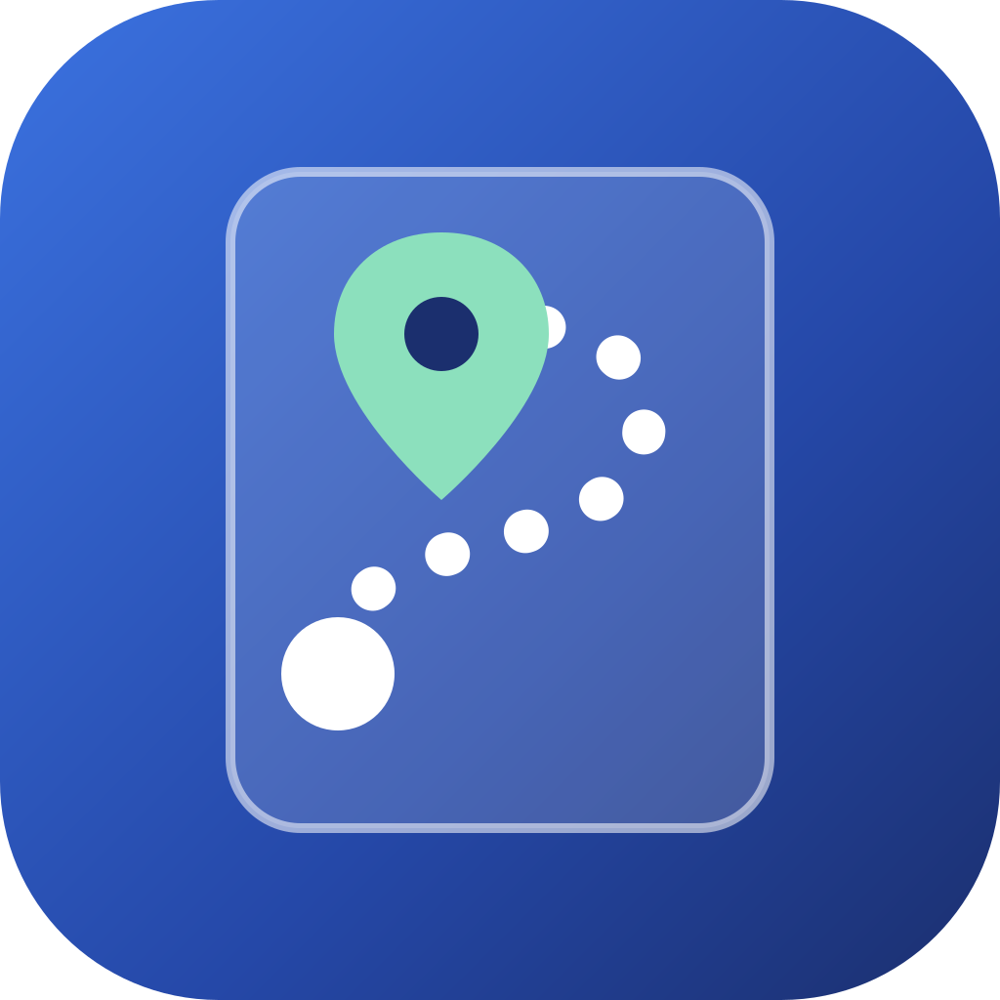

# TourLedger

**Know what every trip cost, what your company still owes you, and what your loans are doing.**<br>
For one person, across your own computer and phone. No account, no sign-up.

[](https://github.com/sudsarkar13/tourledger/releases/latest)
[](https://github.com/sudsarkar13/tourledger/releases/latest)
[](https://github.com/sudsarkar13/tourledger/releases)

[](https://github.com/sudsarkar13/tourledger/actions/workflows/build.yml)
[](LICENSE)


### [⬇ Download the latest version](https://github.com/sudsarkar13/tourledger/releases/latest)

[Features](#-what-you-can-do) · [Screens](#-on-your-computer) · [Install](#-install) · [Sync](#-your-devices-in-step) · [Updates](#-updates) · [Privacy](#-privacy) · [Build](#-build-it-yourself)

<br>

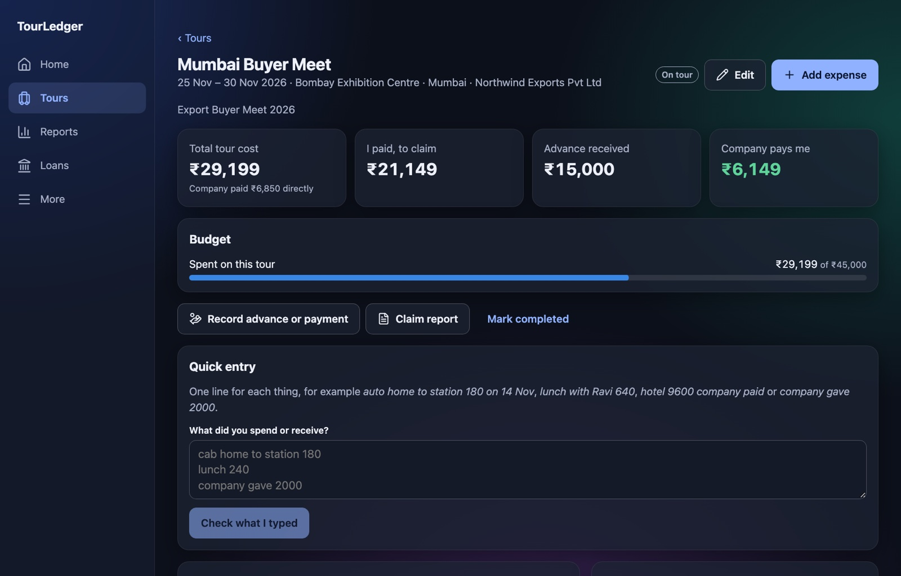

</div>

---

## ✨ What you can do

<table>
<tr>
<td width="50%" valign="top">

### 🧳 Track a tour as it happens
Type `cab home to station 180` or `company gave 2000`, check what was understood, and
save. A note picks the category. Advances, your own spending and what is still due
stay up to date. Rules, not AI.

</td>
<td width="50%" valign="top">

### 🧾 Hand in a clean claim
One tap makes a claim report grouped into travel, food, stay, event and
miscellaneous, with bill photos four to a page. Preview it, then save a PDF or a
spreadsheet. Personal items never appear on it.

</td>
</tr>
<tr>
<td width="50%" valign="top">

### 📊 See where the money goes
Claims by company and tour, what has been reimbursed, what is waiting, and your own
spending by category.

</td>
<td width="50%" valign="top">

### 🏦 Keep loans in view
A separate area for loans and EMIs: what is due, what is overdue, interest paid and
to come, and your debt-free date.

</td>
</tr>
</table>

Also: several employers with your role and colleagues at each, so changing jobs keeps
old claims · business, wellness, reward and personal trips · journey days marked apart
from event days · light and dark themes.

## 💻 On your computer

<table>
<tr>
<td width="50%">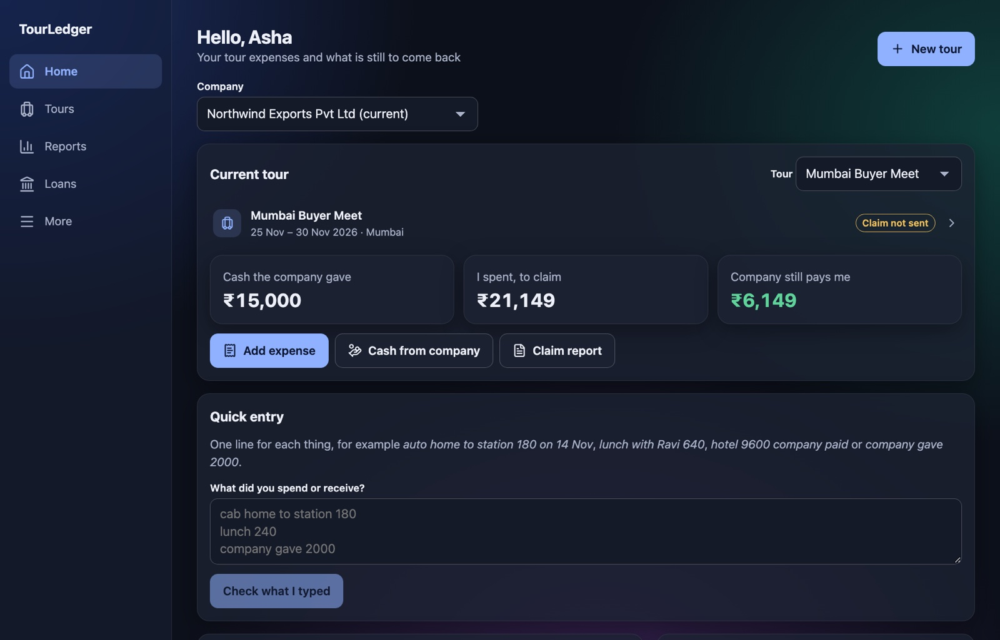</td>
<td width="50%">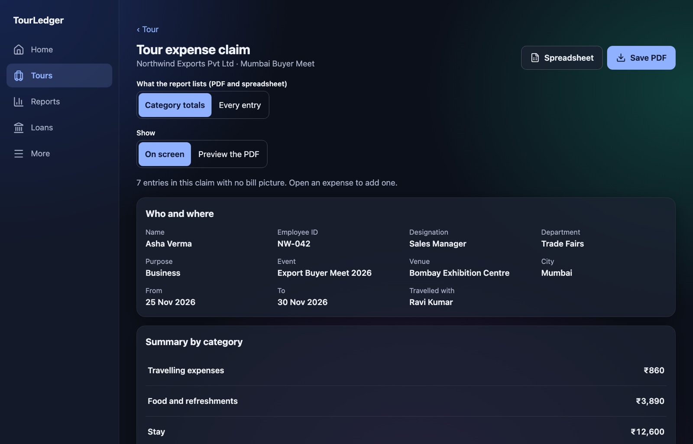</td>
</tr>
<tr>
<td align="center"><b>Home</b>: the trip you are on, and quick entry</td>
<td align="center"><b>Claim report</b>: ready to hand in</td>
</tr>
<tr>
<td width="50%">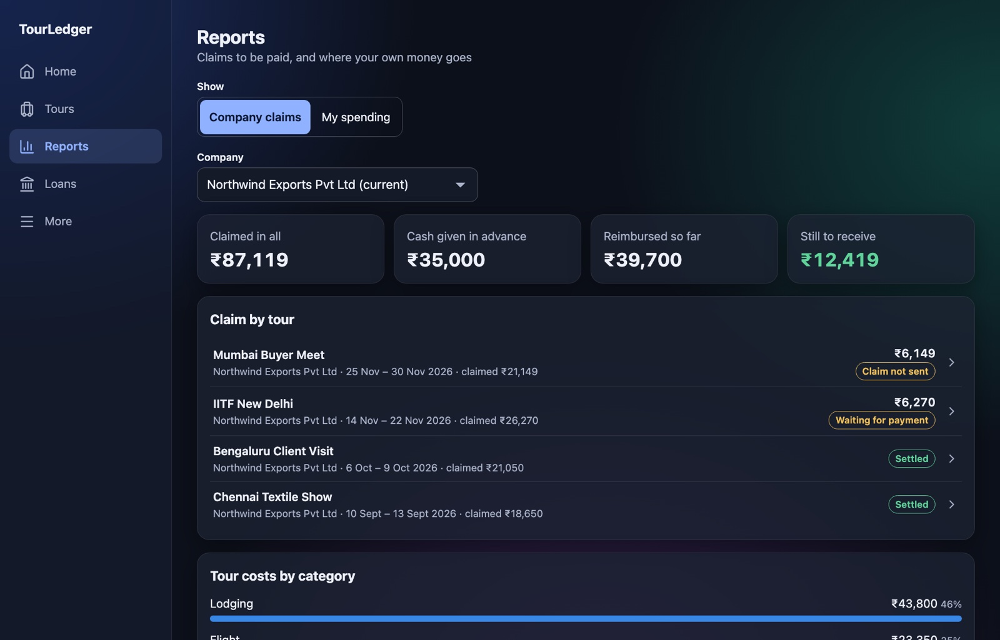</td>
<td width="50%">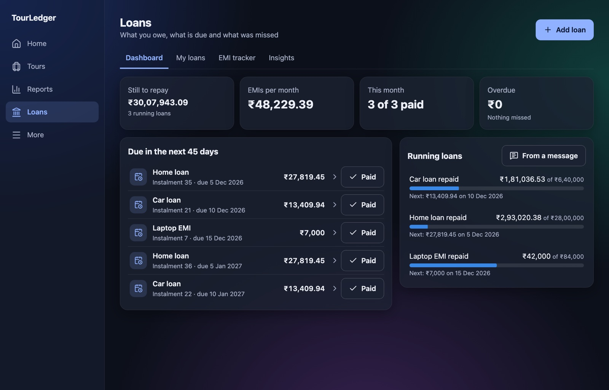</td>
</tr>
<tr>
<td align="center"><b>Reports</b>: what is still to come back</td>
<td align="center"><b>Loans</b>: what is due and what is left</td>
</tr>
</table>

## 📱 On your Android phone

<table>
<tr>
<td width="25%">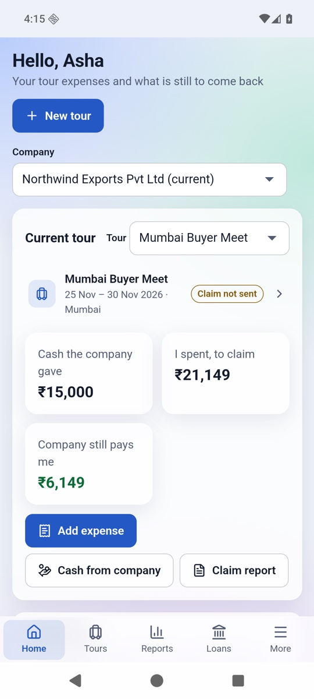</td>
<td width="25%">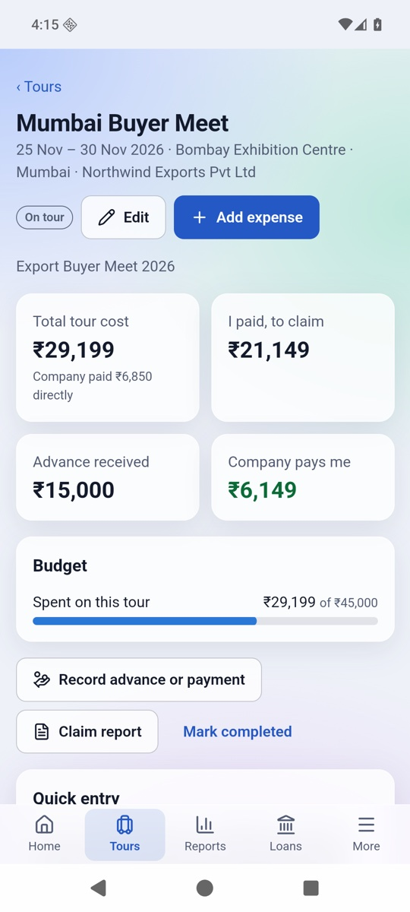</td>
<td width="25%">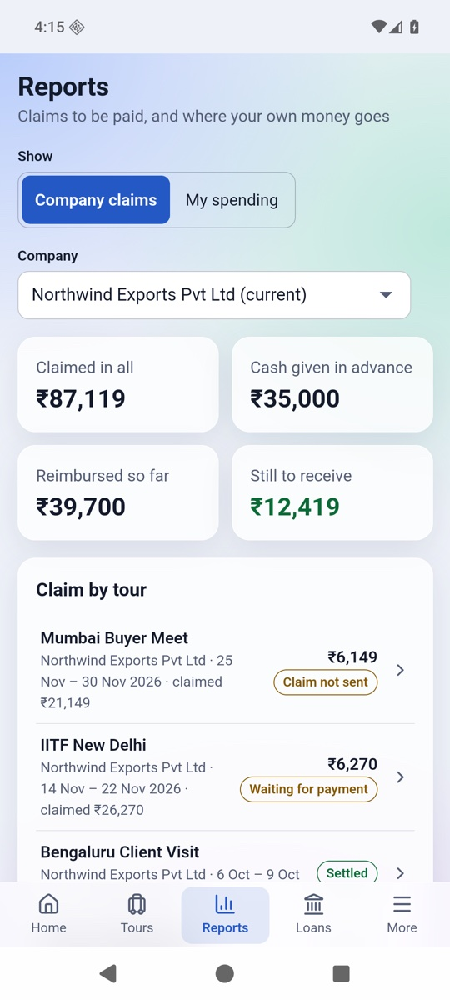</td>
<td width="25%">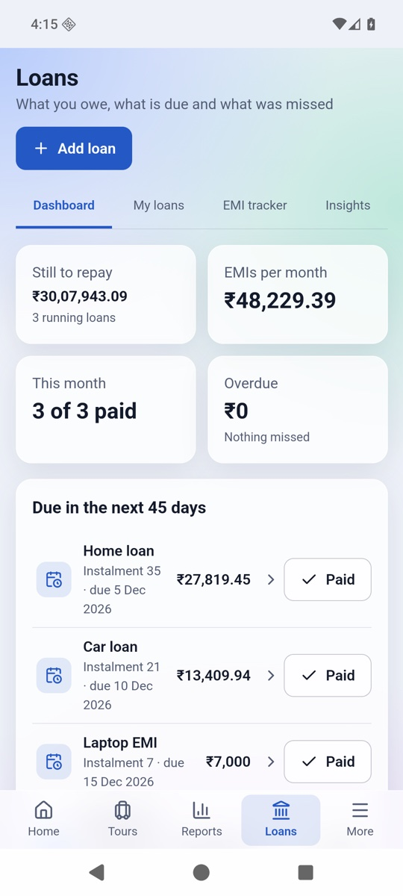</td>
</tr>
<tr>
<td align="center">Home</td>
<td align="center">Tour</td>
<td align="center">Reports</td>
<td align="center">Loans</td>
</tr>
</table>

<details>
<summary><b>📄 See the claim report it produces</b></summary>
<br>
<div align="center">
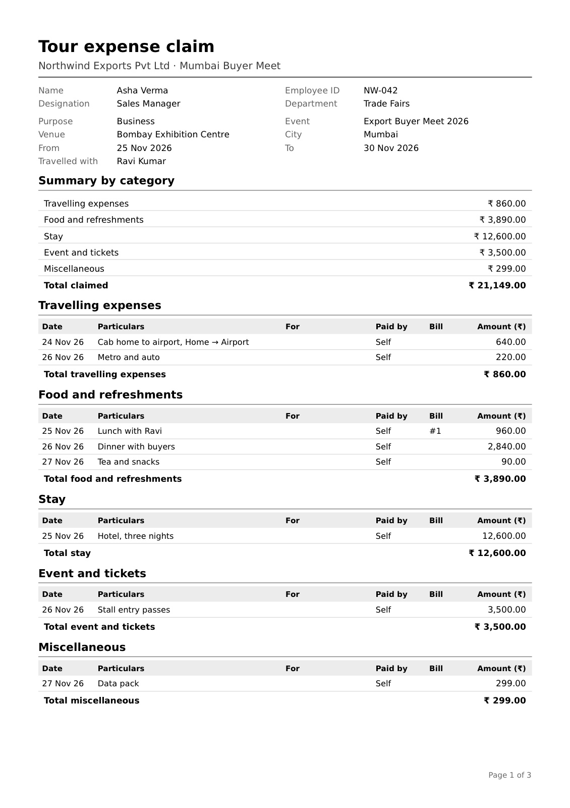
</div>
</details>

<sub>All names, companies and amounts in these pictures are made up.</sub>

## 📦 Install

Get the file for your system from the **[latest release](https://github.com/sudsarkar13/tourledger/releases/latest)**.

| Your system | File | How well tried |
|---|---|---|
| macOS 11+, Apple silicon or Intel | `…_universal.dmg` | Apple silicon in use; Intel not yet |
| Android 8+ (ARM) | `…_android.apk` | Emulator |
| Windows, most PCs | `…_x64-setup.exe` or `.msi` | Built, not yet tried |
| Windows on ARM | `…_arm64-setup.exe` | Built, not yet tried |
| Debian, Ubuntu | `…_amd64.deb` / `…_arm64.deb` | Built, not yet tried |
| Fedora, openSUSE | `…x86_64.rpm` / `…aarch64.rpm` | Built, not yet tried |
| Other Linux | `…_amd64.AppImage` | Built, not yet tried |

iPhone and iPad are not available. FreeBSD can be built from source.

<details>
<summary><b>The security warning you will see, and why</b></summary>

The desktop apps are not signed with a paid developer certificate.

- **macOS:** open the app once, then go to System Settings → Privacy & Security and
  choose **Open Anyway**.
- **Windows, SmartScreen:** choose **More info → Run anyway**.
- **Windows, Smart App Control:** where it is switched on, Windows blocks the installer
  and offers no way to allow just this app.
- **Android:** allow your browser or file manager to install apps when asked.

</details>

### First five minutes

1. **More → My details**, then add your company and role.
2. Add the colleagues you travel with.
3. **New tour**, then type your first expense into **Quick entry**.

## 🔄 Your devices, in step

Sync is off until you turn it on, and works only between devices you link yourself.

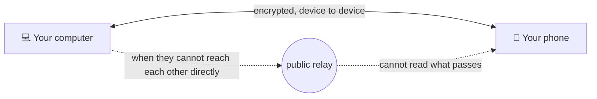

1. On one device: **More → Sync → Show my code**.
2. On the other: **More → Sync → Enter a code** (or **Scan a code** on Android).
3. Keep both apps open to exchange changes.

Unlinking on either device ends the link on both. To keep one tour or loan off your
other devices, turn on **this device only** in its form.

## ⬆ Updates

From version 0.1.2 TourLedger updates itself from these releases: it checks when opened
and daily while open, downloads, and asks before installing. **Your entries stay.** Check by hand or switch
it off under **More → Updates**. Versions 0.1.0 and 0.1.1 need one manual install first.

| System | What happens when you accept |
|---|---|
| macOS, Linux AppImage | Installs and restarts |
| Windows | Closes, runs the installer, opens again |
| Linux deb / rpm | Asks for your password |
| Android | Installs and closes; open it again. The first time, allow it to install apps |

Desktop updates are installed only if signed with the project's update key; Android
accepts only an APK signed with the same key as the app you have.

## 🔒 Privacy

- No account, and no server of ours. Your ledger is a file on your device.
- Sync is encrypted between your own devices. It uses public relay and discovery
  services to find and reach them.
- The update check asks GitHub for the newest release. Nothing from your ledger is
  sent, though GitHub sees your internet address. You can switch it off.
- The files are **not encrypted by the app**. Keep disk encryption on and make backups
  from **More → Backup and import**.

<details>
<summary><b>Where your data is</b></summary>

| System | Folder |
|---|---|
| macOS | `~/Library/Application Support/app.tourledger` |
| Windows | `%APPDATA%\app.tourledger` |
| Linux | `~/.local/share/app.tourledger` |
| Android | the app's private storage |

`ledger.tlg` is your data, `bills/` holds the bill pictures, and `device.json` is this
device's identity and keys.

</details>

<details>
<summary><b>Known limits</b></summary>

- Editing the same entry on two devices before they sync keeps the later edit only.
- A restore does not bring back items deleted after the backup was made, if the ledger
  still remembers the deletion.
- Bills are pictures only (no PDF invoices). No per-diem rules or notifications while
  the app is closed.
- The PDF cannot draw Indian scripts; such characters print as `?`.
- Amounts are shown in rupees; other currencies are converted at your entered rate.
- Nothing can erase data from a lost device. Unlinking works per pair: unlink the lost
  device on each of your other devices, or one of them will keep forwarding changes.

</details>

## 🛠 Build it yourself

A Rust core with its own storage format (`crates/core`), peer-to-peer sync over
[iroh](https://www.iroh.computer/) (`crates/sync`), and a React interface in a
[Tauri 2](https://v2.tauri.app/) shell.

You need Rust (stable), Node 24+ and pnpm.

```bash
pnpm --dir ui install
```

```bash
ui/node_modules/.bin/tauri dev
```

<details>
<summary><b>Tests, browser development, and builds</b></summary>

Tests:

```bash
cargo test
```

```bash
pnpm --dir ui test
```

Sync over the public network (needs internet):

```bash
cargo test -p tourledger-sync -- --ignored
```

**UI in a plain browser.** Run the development bridge and the UI server in two
terminals, then open http://127.0.0.1:1420. The bridge has no authentication and is for
development only.

```bash
cargo run -p tourledger-devbridge
```

```bash
pnpm --dir ui dev
```

**Builds.** `scripts/build.sh` builds for the desktop system you run it on.
`scripts/build.sh android` and `scripts/build.sh ios` need the Android SDK/NDK or full
Xcode. CI (`.github/workflows/build.yml`) runs for version tags and when started by
hand.

</details>

More: [architecture](docs/ARCHITECTURE.md) · [scenarios](docs/SCENARIOS.md) ·
[design rules](docs/DESIGN.md) · [platforms and releasing](docs/PLATFORMS.md) ·
[installing on macOS](docs/MACOS-INSTALL.md)

---

<div align="center">

[MIT](LICENSE) © 2026 Sudeepta Sarkar

<sub>Found something broken? <a href="https://github.com/sudsarkar13/tourledger/issues">Open an issue</a>.</sub>

</div>
